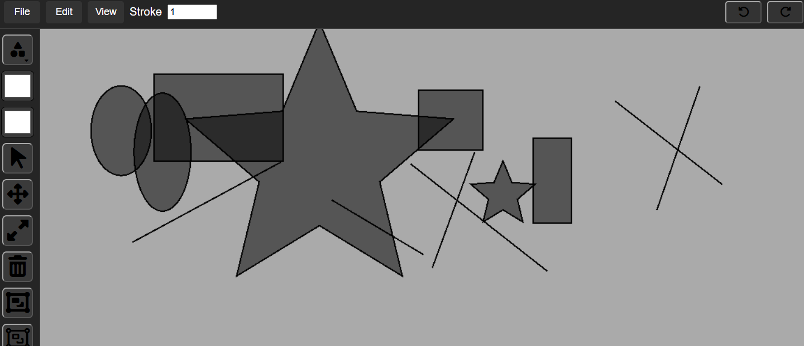
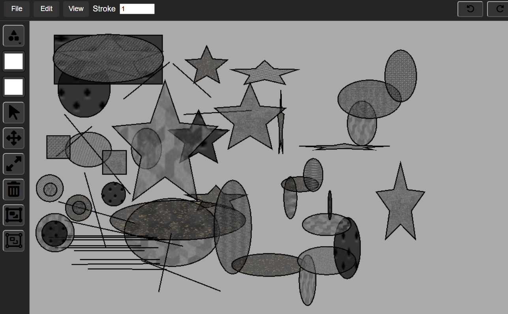

# paintingApp
node.js painting application

pixie.js (can be used to build games)
adArcade
npm run build
//inspect element on {npx vite preview //// npm run dev} to debug
graphics class
https://pixijs.com/8.x/guides/components/scene-objects/graphics/graphics-fill 

main.js contains tools 
managers/ToolsManager.js connects to id="tool-panel" in index.html
.rect .circle .lineStyle .drawStar

xml - <sender>tove<sender>
json - sender:tove

### goals 4 week 1: 
- draw shapes based on what state you are in (onPointerDown or onPointerUp or pointerMove (click and drag)) at the location that pointer is down (if pointer is down on div id="pixie-container")
- use states (state pattern ((design patterns)))
- ((factory patterns, observer pattern, singleton principle - export default))
- drawCircle drawLine drawStar etc 
* shapes stored in Container (pixie.js) class (and constantly add children to)
- include link to repo in canvas

## week 1: takeaways

- added 4 state classes :: circle, rect, line, star 
- added `DrawManager` keeps track of the current drawing state
- `inputManager` already has onPointerUp, onPointerDown, onPointerMove so i didnt need to add those again ,,, they r used in the states a lot (possible TD??)
- 4 the star.........
        - the outer radius is the distance from the center to the tip (onPointerMove)
        - the inner radius is the distance from the center to the little divots between the tips. 
            - /// smaller inner radius = deeper divots (currently set 0.45)

#### week 1 feedback:
- "" maybe even put in a hotkey to hold shift that will force a perfectly scaled 1:1 length width shape instead of distorted
- "" manipulate the scale. star.scale.x star.scale.y or star.scale.set(x,y) so its not the same proportions every time
- maybe add patterns..?

### updates from feedback:: 

### goals / notes 4 week 2: 
- npm run dev
- managers/ historyManager
- main/ historyManager.undo, historyManager.redo
    - history stack / undo stack 
    - press undo / will move the action to the undo stack , pop it from the history stack 
    - press redo /  will pop off top of undo stack and move it to the top of history stack 
- undo/redo in a stack (FILO)
- undo / redo / execute (every action has a reaction)
- actions/ DrawRectAction.js, etc (undo(), redo(), execute() => {//building out the shape})
- change DrawRectState
    - currently it draws the rectangle // we r going to change/relocate what is inside of the onPointerMove/onPointerDown/onPointerUp classes so that the DrawRectAction class is whats happening when you release / draw (this is the action of drawing)
    - add instance of DrawRectAction and let action draw for you 
    - and add it to historyManager
- add colors as values to pass into an action (first is fill/second is stroke)
- add stroke weight / stroke type 
- star center is off center a little bit 

*** extra (next week tbd) --------------*** 
- actions/
    - ***selecting (when i select i want an outline)***
        - selecting in Utils AABB for drag and select 
        - on selectState onPointerDown if pointerMove is <= 1px, grab top element if elements exist at that point
        - i want the outline to be in front of everything
        - layersManager (shapes, outline)
    - deleting
    - moving 
    - scaling 
    - rotating 
- sideview layer panel where you can group or ungroup selectively or reorder as you wish 
- pixie.js container to store all shapes and etc (right now the stage is the container)
    - we will have shapes container / preview selection container / another container for taking things out to group them and then inserting that container back into the hierarchy (on the top)
*extra extra*
- brushes in a container of infinate recngles until pointer up 
- sound effects 
- stamp feature / stamp tool 
- fill tool / paint bucket
- canvas background options
- export/print/share screen/canvas 
- duplicate feature
- keyboard shortcuts (ctrl z, ctrl shift z/ ctrl y, ctrl c + v, ctrl x, ctrl d, ctrl p, backspace)